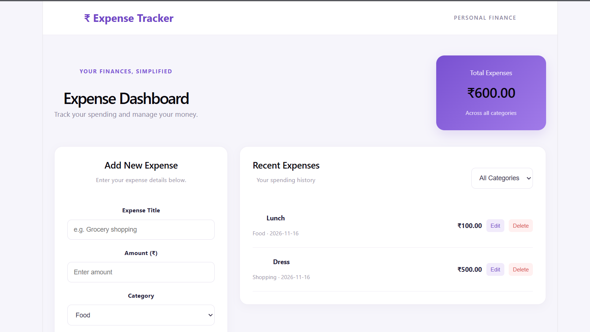
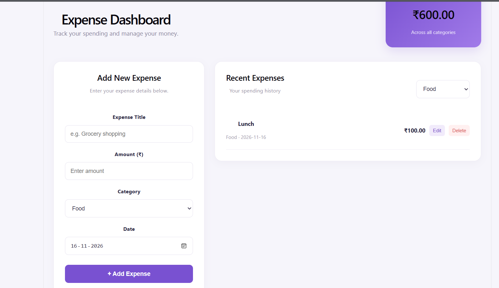
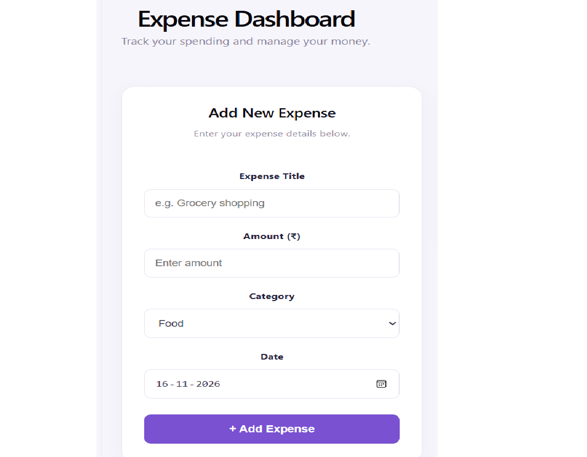

# Expense Tracker Web Application

A full-stack Expense Tracker application developed using React, Java Spring Boot, and MySQL. It helps users manage daily expenses easily.

## Features
- Add new expenses
- View all expenses
- Edit existing expenses
- Delete expenses
- Filter expenses by category
- Calculate total expenses
- Input validation
- Store expense records in MySQL

## Technologies Used
- **Frontend:** React, JavaScript, HTML, CSS
- **Backend:** Java, Spring Boot, Spring Data JPA, Maven
- **Database:** MySQL

## Expense Categories
- Food
- Travel
- Shopping
- Bills
- Other

## Project Structure
- `frontend/` – React application
- `backend/expense-tracker/` – Spring Boot application
- `screenshots/` – Project screenshots
- `README.md` – Project documentation

## Database Configuration
1. Install MySQL.
2. Create a database named `expense_tracker`.
3. Go to `backend/expense-tracker/src/main/resources/`.
4. Create an `application.properties` file using `application.properties.example` as a reference.
5. Enter your own MySQL username and password.

**Important:** Never upload your actual database password to GitHub.

## How to Run the Project

### Backend
Open a terminal inside `backend/expense-tracker` and run:

```bash
.\mvnw.cmd spring-boot:run
```

Backend URL: `http://localhost:8080`

### Frontend
Open another terminal inside `frontend` and run:

```bash
npm install
npm run dev
```

Open the local URL shown in the terminal, usually `http://localhost:5173`.

## API Endpoints

| Method | Endpoint | Description |
|---|---|---|
| POST | `/api/expenses` | Add an expense |
| GET | `/api/expenses` | Get all expenses |
| GET | `/api/expenses?category=Food` | Filter expenses |
| PUT | `/api/expenses/{id}` | Update an expense |
| DELETE | `/api/expenses/{id}` | Delete an expense |

## Validation
- Title cannot be empty.
- Amount must be greater than zero.
- Category and date are required.
- Invalid requests return HTTP 400.
- Missing expense records return HTTP 404.

## Screenshots

### Dashboard


### Category Filter


### Add Expense


## Author
Perarasi A

**Project:** Expense Tracker Web Application  
**Technology:** Java Full Stack